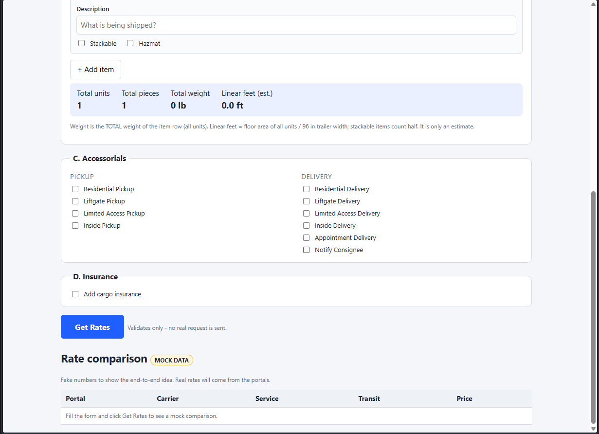

ShipmentInfo
├── ship_date: date
├── origin: Location
└── destination: Location

Location
├── country: Country (enum: US/CA/MX)
├── zip: str
├── city: str | None
├── state: str | None
└── location_type: LocationType (business, residential...)   ← thêm theo review

Item (một dòng hàng)
├── handling_unit: HandlingUnit (enum)
├── units: int
├── pieces: int | None
├── length_in, width_in, height_in: float
├── weight_lb: float
├── freight_class: FreightClass (enum)
├── nmfc: str | None
├── description: str
├── stackable: bool
└── hazmat: bool (+ HazmatInfo nếu true)

Accessorials
├── pickup: list[PickupAccessorial]
└── delivery: list[DeliveryAccessorial]

Insurance
├── insured: bool
└── declared_value: float | None

QuoteRequest        ← gom tất cả, đây là payload chuẩn
├── shipment: ShipmentInfo
├── items: list[Item]
├── accessorials: Accessorials
└── insurance: Insurance
